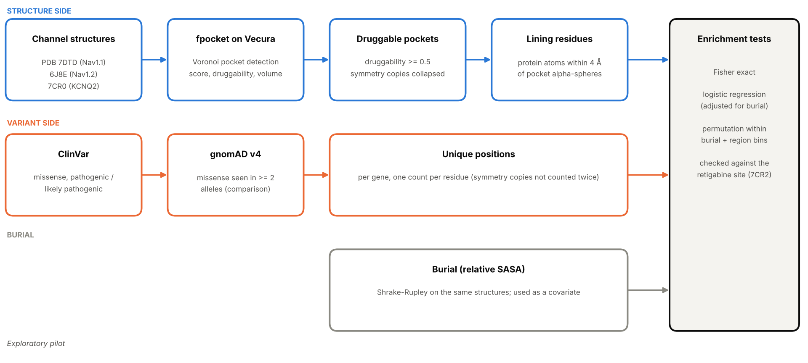
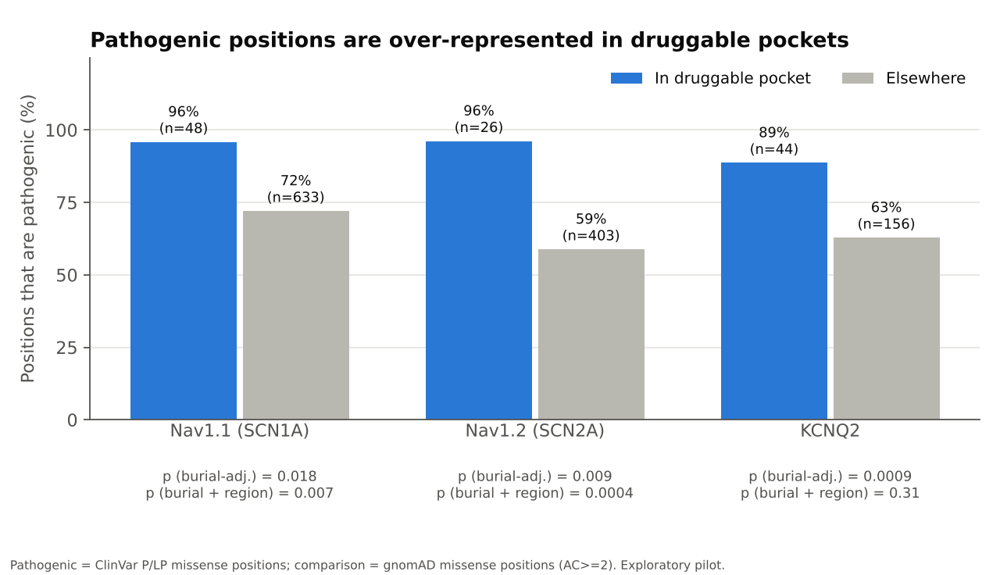
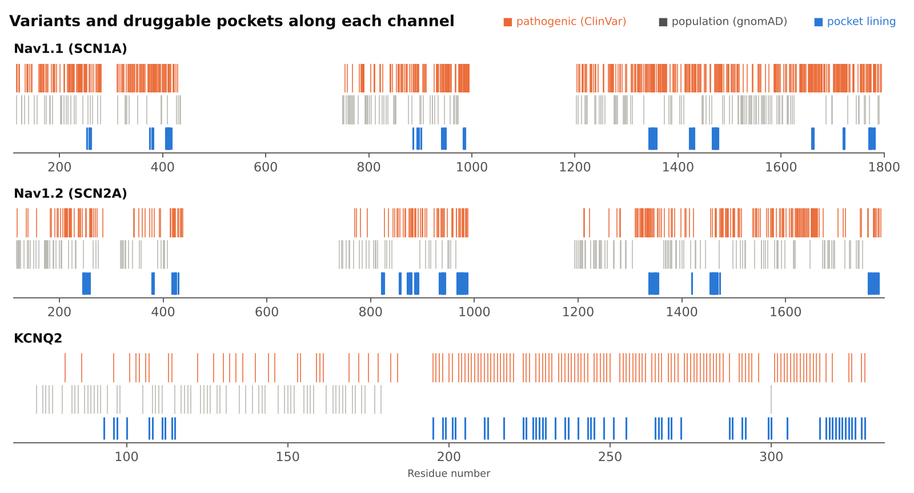
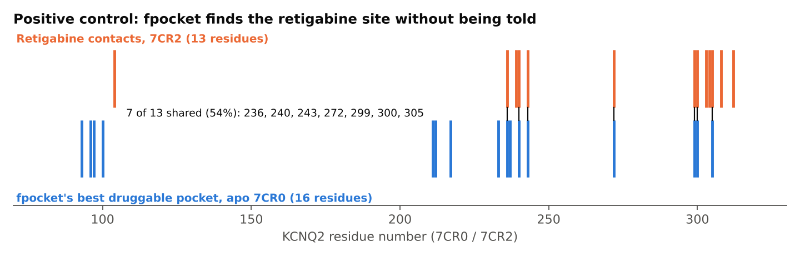

# Epilepsy-Channel Pocket Atlas (pilot)

Do pathogenic missense variants in epilepsy ion channels fall in computationally druggable pockets more often than expected?
Pilot on **Nav1.1 (SCN1A), Nav1.2 (SCN2A), KCNQ2**, with pockets detected by **fpocket on the Vecura platform**.

**Status: exploratory pilot, not a validated result.**

## Pipeline overview


## Figures


*Fig 1. Fraction of positions that are pathogenic, inside vs outside druggable pockets (labelled positions only).*



*Fig 2. Pathogenic (orange), population-only (gray) and pocket-lining (blue) positions along each channel. Gray marks positions seen in gnomAD that are not pathogenic, so it thins out where pathogenic coverage is dense (e.g. KCNQ2 residues ~195-330). That imbalance is the ascertainment problem the region-matched test tries to control for.*



*Fig 3. KCNQ2 positive control: 7 of 13 retigabine-contact residues (7CR2) line fpocket's best druggable pocket in the apo structure (7CR0).*

## Pipeline
1. **Pockets**: fpocket (Vecura) on PDB 7DTD (Nav1.1), 6J8E (Nav1.2), 7CR0 (KCNQ2). Druggable = druggability score >= 0.5. Outputs are in `data/pockets/`.
2. **Lining residues**: protein residues with any heavy atom within 4 A of a pocket's alpha-spheres (`scripts/01`, `02`).
3. **Variants**: ClinVar missense (pathogenic/likely pathogenic = case positions; benign/likely benign = sensitivity only) and gnomAD v4 missense seen in >= 2 alleles (controls). Pulled in the browser with `browser/*.js`, stored as hex bitsets of unique residue positions in `data/variants/`.
4. **Tests** (`scripts/03`-`06`): residue-level (unique positions), Fisher exact, logistic regression adjusted for relative solvent accessibility, and permutation within burial bins (and sequence windows).
5. **Positive controls**: (a) fpocket's best KCNQ2 pocket lines 7/13 retigabine-contact residues in 7CR2 (`browser/retigabine_contacts.js`). (b) Nav1.7 + lamotrigine, 8THH (`browser/lamotrigine_control.js`): site 1 is lined by a druggable pocket (druggability 0.997, 11/13 contact residues); site 2 is also detected as a pocket (7/8 contact residues) but fpocket scores it 0.078, so a druggability >= 0.5 cut-off would miss it.

## Run
```
pip install -r requirements.txt
cd scripts
python3 03_build_table.py && python3 04_clinvar_background_test.py && python3 05_region_matched_test.py && python3 06_gnomad_control_test.py && python3 07_figures.py && python3 08_pipeline_diagram.py
```

## Pilot results (pathogenic positions, pocket vs elsewhere, gnomAD controls)
| Channel | In pocket | Elsewhere | p (burial-adj.) | p (burial + region) |
|---|---|---|---|---|
| Nav1.1 | 96% | 72% | 0.018 | 0.007 |
| Nav1.2 | 96% | 59% | 0.009 | 0.0004 |
| KCNQ2 | 89% | 63% | 0.0009 | 0.31 |

## Limitations
- Pocket residues are buried and conserved; burial adjustment only partly separates "pocket" from "constrained".
- ClinVar is biased towards tested hotspots. Few pocket residues carry any gnomAD variant.
- Nav structures contain the alpha subunit only (no membrane or beta subunits). KCNQ2 pocket list was assembled from druggable pocket classes, not a full table.
- Numbering between ClinVar/gnomAD and structures is assumed to match; spot-checked only.
- fpocket's druggability score can miss small fenestration-type drug sites (lamotrigine site 2 in 8THH scored 0.078), so the >= 0.5 definition is conservative. Novelty search was brief.
